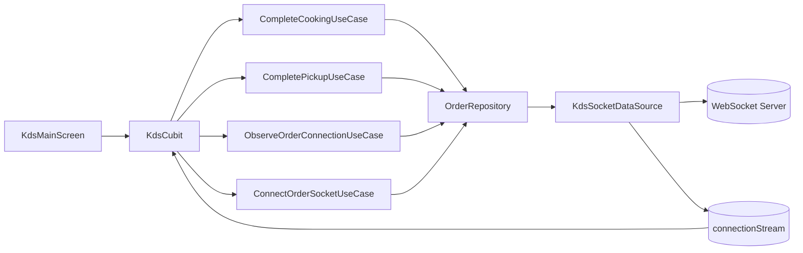

# FlowHub KDS

FlowHub KDS is a Flutter application built with Clean Architecture, Cubit for state management, and WebSocket communication for real-time pickup table updates.

## 1. Project Goals

- Display order cards on the KDS screen.
- Handle key actions:
  - Cooking completed.
  - Pickup completed.
- Send ORDER_READY events over WebSocket.
- Track socket connection status in real time.

## 2. Environment and Requirements

### 2.1 SDK

- Flutter: 3.32.8 (locked in `.fvmrc`)
- Dart SDK: >= 3.8.0 < 4.0.0 (from pubspec)

### 2.2 Required Toolchain Versions

- FVM: recommended (for team-wide Flutter version consistency)
- Java (JDK): 17+ (JDK 17 LTS recommended)
- Gradle Wrapper: 8.12 (`android/gradle/wrapper/gradle-wrapper.properties`)
- Android Gradle Plugin (AGP): 8.7.3 (`android/settings.gradle.kts`)
- Kotlin Android Plugin: 2.1.0 (`android/settings.gradle.kts`)

### 2.3 Verify Local Environment

Run these commands before first build:

```bash
fvm use 3.32.8
fvm flutter --version
fvm dart --version
java -version
```

Optional Android checks:

```bash
cd android
./gradlew -version
```

Expected result:

- Flutter 3.32.8
- Dart 3.8.x
- Java 17+ and Gradle 8.12

### 2.4 Core Packages

- flutter_bloc
- get_it + injectable
- freezed + json_serializable
- dio + retrofit
- fpdart

## 3. Quick Setup

### 3.1 Install dependencies

```bash
flutter pub get
```

If you use FVM in this repository, select the expected Flutter version first:

```bash
fvm use
```

### 3.2 Generate code (freezed/json/retrofit/injectable)

```bash
flutter pub run build_runner build
```

If regeneration is needed due to conflicting outputs:

```bash
flutter pub run build_runner build --delete-conflicting-outputs
```

### 3.3 Run static analysis

```bash
flutter analyze --no-fatal-infos
```

### 3.4 Recommended startup flow

```bash
flutter pub get
flutter pub run build_runner build
flutter run -t lib/main_dev.dart
```

## 4. Running by Environment

The project has two main entrypoints:

- Dev: lib/main_dev.dart
- Prod: lib/main_prod.dart

`lib/main.dart` currently acts as a plain app entry and does not initialize DI/environment setup. For normal development and QA runs, use `main_dev.dart` or `main_prod.dart`.

Run dev:

```bash
flutter run -t lib/main_dev.dart
```

Run prod:

```bash
flutter run -t lib/main_prod.dart
```

Notes:

- setupLocator(Env.dev()) and setupLocator(Env.prod()) are called in each entrypoint.
- Env currently has empty default apiUrl values, so pass proper values when HTTP API integration is needed.
- WebSocket connection settings are currently hardcoded inside the remote socket datasource.

## 5. Folder Structure

```text
lib/
  core/
    constants/         # shared constants (network timeout, etc.)
    di/                # get_it + injectable config
    env/               # environment model
    exceptions/        # shared exception area (for future expansion)
  data/
    exceptions/        # exception handler implementation
    models/            # DTO/raw model + mapper
    network/           # dio, interceptor, retrofit client
    repositories/      # repository implementations
    sources/
      remote/          # websocket/api datasource
      local/           # local datasource (reserved)
  domain/
    entities/          # business entities
    enums/             # business enums
    exception/         # base exception/failure types for domain
    repositories/      # repository contracts
    usecases/          # business use cases
  presentation/
    cubit/             # state management (Cubit + State)
    screens/           # UI screens
    routes/            # router (if expanded)
    widgets/           # reusable widgets
```

## 6. Project Rules

### 6.1 Clean Architecture

- Presentation should call use cases, not data sources directly.
- Cubit should not access data layer classes directly.
- Domain should not depend on Flutter widgets.
- Data layer must implement contracts defined in domain.

### 6.2 State Management

- Prefer one Cubit + one State per feature screen.
- KdsState uses Freezed for immutable state and safe copyWith.

### 6.3 Error Handling

- UseCase returns Either<BaseException, T>.
- Exception mapping is handled through BaseExceptionHandler.

### 6.4 Generated Files

- Do not edit generated files directly:
  - *.freezed.dart
  - *.g.dart
  - di.config.dart
- Edit source files only, then run build_runner again.

### 6.5 Hardcoded UI Text

- KDS screen text is extracted into:
  - lib/presentation/screens/kds_screen/kds_main_texts.dart

### 6.6 index.dart Barrel Export Rule

- For each feature/layer folder, expose public files through `index.dart`.
- Prefer importing from folder `index.dart` instead of importing deep file paths in many places.
- Whenever a new public file is added, update that folder's `index.dart` in the same change.
- Keep `index.dart` for exports only. Do not place business logic there.

Example:

```dart
// lib/domain/usecases/index.dart
export 'complete_cooking_usecase.dart';
export 'complete_pickup_usecase.dart';
```

## 7. KDS Usage Flow

### 7.1 Main Flow

1. App starts and KdsCubit is injected.
2. KdsCubit subscribes to connectionStream through ObserveOrderConnectionUseCase.
3. KdsCubit triggers ConnectOrderSocketUseCase to open socket connection.
4. User taps Cooking completed:
   - Cubit calls CompleteCookingUseCase.
   - Repository calls KdsSocketDataSource.sendOrderReady(...).
   - State updates order.status to ready.
5. User taps Pickup completed:
   - Cubit calls CompletePickupUseCase.
   - State moves order to the end and resets status to pending.

### 7.1.1 Current transport details

- Socket datasource: `lib/data/sources/remote/kds_socket_data_source.dart`
- Current protocol: WebSocket
- Current payload type for cooking completion: `ORDER_READY`
- Current server host/port are hardcoded in the datasource and should be moved to environment/config if they need to vary by build.

### 7.2 Data Flow Overview



## 8. DI and Lifecycle

- DataSource: singleton
- Repository: singleton
- UseCase: injectable (stateless)
- Cubit: injectable with screen lifecycle

DI setup location:

- lib/core/di/di.dart

## 9. Available Scripts

In scripts/:

- gen_code.sh: run build_runner code generation
- gen_all.sh: run build_runner + fluttergen
- get_asset.sh: run fluttergen

Current script notes:

- `gen_all.sh` requires `fluttergen` to be installed and available in PATH.
- If `fluttergen` is not installed, use `gen_code.sh` or run `flutter pub run build_runner build` directly.

If a script fails with command not found:

- Ensure required commands are installed, or run equivalent flutter/dart commands directly.

## 10. Common Troubleshooting

### 10.1 Missing implementation for custom Freezed methods

If your Freezed model has custom methods (for example, toEntity), add a private constructor:

```dart
const ModelName._();
```

### 10.2 retrofit_generator parser-related errors

Keep retrofit and retrofit_generator versions aligned and compatible with the current Dart SDK.

### 10.3 Duplicate injectable registrations

Make sure there are no duplicate classes registered as the same abstract type under the same environment/scope.

### 10.4 App starts but DI is missing

If you run the app from `lib/main.dart`, DI is not initialized. Run with one of the environment entrypoints instead:

```bash
flutter run -t lib/main_dev.dart
```

## 11. References

- Flutter docs: https://docs.flutter.dev/
- Bloc library: https://bloclibrary.dev/
- Freezed: https://pub.dev/packages/freezed
- Json Serializable: https://pub.dev/packages/json_serializable
- Injectable: https://pub.dev/packages/injectable
- GetIt: https://pub.dev/packages/get_it
- Retrofit Dart: https://pub.dev/packages/retrofit
- Dio: https://pub.dev/packages/dio
- fpdart (Either): https://pub.dev/packages/fpdart
